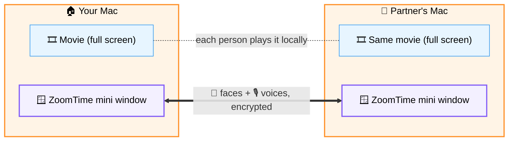
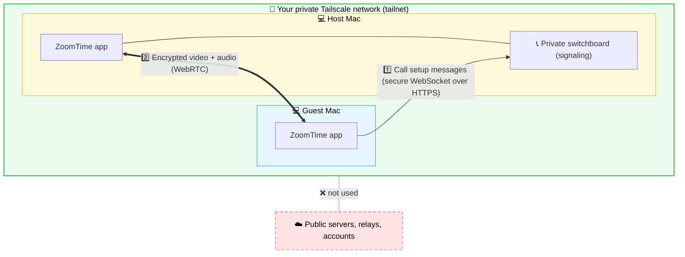
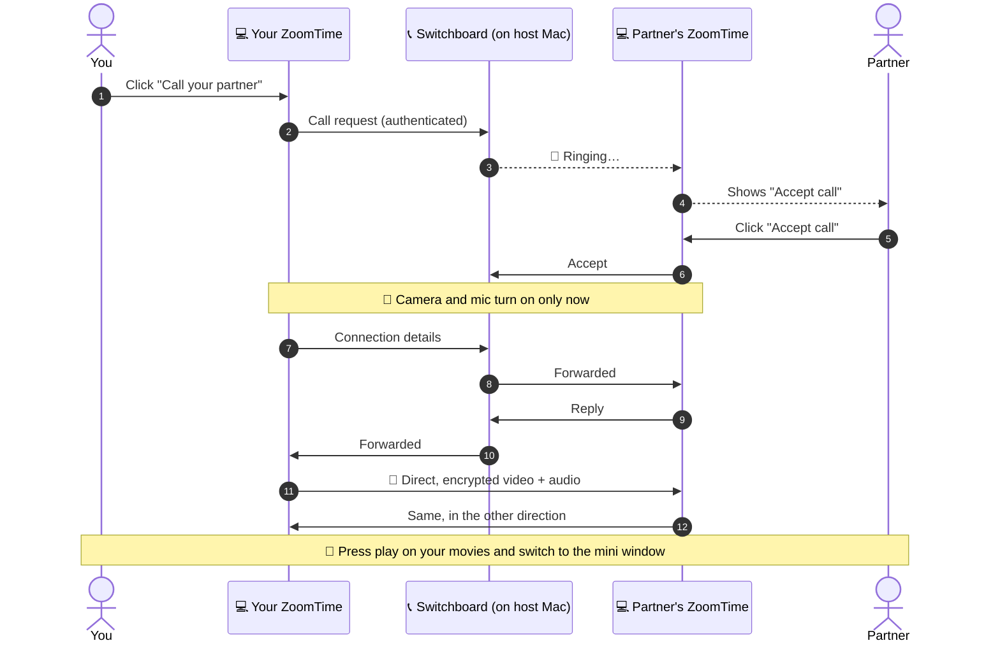
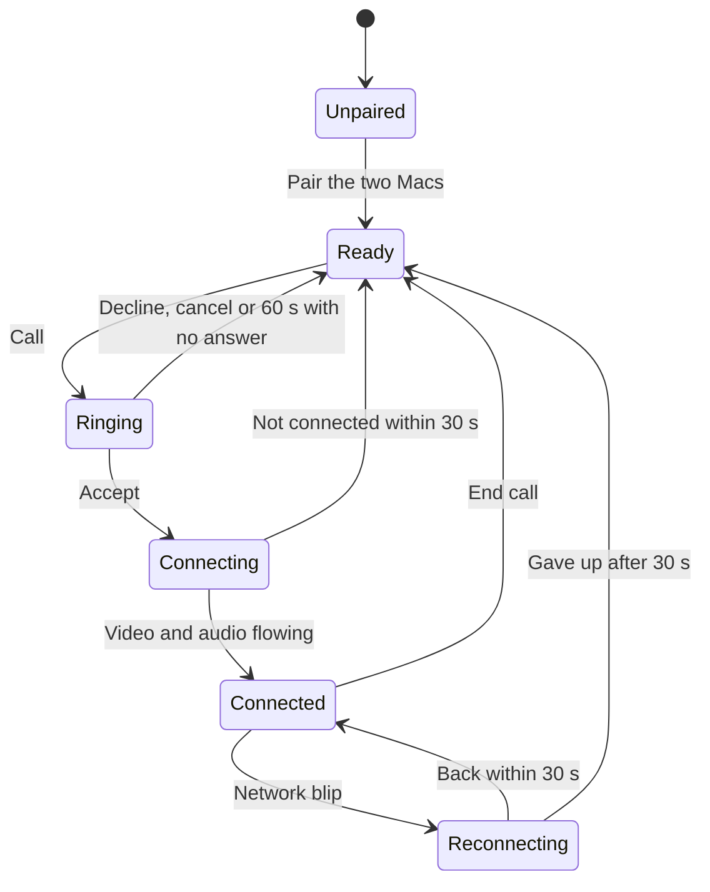
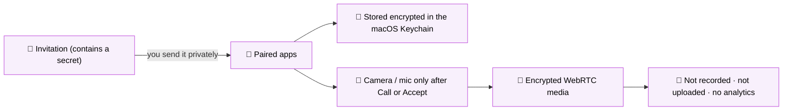
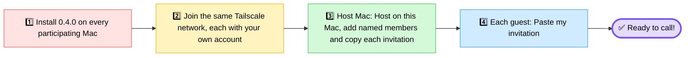

# 🎬 ZoomTime

### *Movie night with your people, even far away.*

A tiny, private video-call window that floats over your full-screen movie, 
so your private group can watch together and still see each other.

**[⬇️ Download](#-get-it) · [🚀 Set up in 4 steps](#-set-up-in-4-steps) · [🧠 How it works](#-how-it-works) · [📚 Technical guide](docs/TECHNICAL_GUIDE.md)**

> **v0.4.0 prerelease — group calling:** one private group of 2–5 named members, selected recipients, in-call invitations, grid/pin and speaker highlighting. All participants must upgrade together. Requires Apple Silicon and macOS 14+. Physical multi-Mac performance remains under test. [Release notes](docs/releases/v0.4.0.md).
> **Update inside the app:** open Settings → Check for updates → Download update → Install and restart (0.3.4 or later). Older versions may finish installation in Finder. No background updates.
> **Known screen-share/screen-capture permission bug:** macOS may repeatedly request Screen Recording access or refuse capture after access is enabled. This remains unresolved. Settings includes recovery guidance, but this release does not claim to fix it. Screen capture is a local diagnostic; partner screen transmission and protected-video capture are not implemented.
> **Safari overlay remains under test:** controlled Safari/full-screen and focus regression checks remain pending. See the [acceptance matrix](docs/superpowers/plans/2026-10-17-group-calling-acceptance.md).

---

## 💡 What is ZoomTime?

ZoomTime supports **private calls for two to five named people on Apple Silicon Macs**. Its main job is a small, resizable video window of your group that **floats on top of everything, including a full-screen movie**.

Each of you plays the movie on your own Mac. ZoomTime only carries your faces and voices, so it feels like sitting on the same couch even when you're in different cities.

---

## 🎯 What problem does it solve?

Watching a movie "together" over a normal video call quickly becomes awkward:

| 😩 The usual way | 🎬 With ZoomTime |
| --- | --- |
| Call windows are big and cover the movie | Mini window shrinks down to **160 × 90** and sits in a corner |
| Full-screen video hides the call | Mini window **floats over full-screen apps** and Spaces |
| Minimised call windows can pause or freeze | The **same live call** carries on in normal *and* mini mode |
| Free plans often cut meetings off after a set time | **No time limit** in the app (it stays on as long as the host, participants and network do) |
| Accounts, servers, subscriptions | **No ZoomTime accounts, no servers to rent, no payment** |
| Your call goes through a company's cloud | Calls stay on **your own private Tailscale network** |
| Screen sharing the movie lowers quality | Nobody streams the movie. **Each Mac plays it at full quality** |

> [!TIP]
> Think of it as a **picture-in-picture window of your partner** that works with any video player on your Mac.

---

## ✨ Features

<table>
<tr>
<td width="50%" valign="top">

### 🪟 Floating mini window
- Floats over full-screen movies
- Starts at **320 × 180** and resizes down to **160 × 90**
- Video fits the window without stretching
- Controls show up on hover or <kbd>Tab</kbd>
- <kbd>⌘</kbd><kbd>⇧</kbd><kbd>M</kbd> toggles mini · <kbd>Esc</kbd> restores

</td>
<td width="50%" valign="top">

### 🎥 Look and sound your best
- Camera quality: **360p**, **720p** (default) or **1080p**
- Mirror your own preview (your partner sees you normally)
- Optional, resizable self-preview in mini mode
- **Camera & mic check** before calling, with a live level meter

</td>
</tr>
<tr>
<td width="50%" valign="top">

### 🔒 Private by design
- Encrypted WebRTC audio and video
- Pairing secret kept in the macOS **Keychain**
- Camera/mic turn on only when you press **Call** or **Accept**
- No call recording, analytics, chat logs or call history. The explicit local screen diagnostic saves H.264/PNG only after Start.

</td>
<td width="50%" valign="top">

### 🧩 Easy to live with
- **Host on this Mac** sets up the private connection for you
- Reconnects on its own after short network blips
- **Check for Updates** with checksum-verified downloads
- Follows macOS light and dark mode

</td>
</tr>
</table>

---

## 🧠 How it works

ZoomTime uses one private group of **up to five Macs**, with one **host** running the private signaling switchboard. Everyone has an individual pairing invitation and sees named contacts. Select who to call; each person explicitly accepts. Participants can invite other paired members while a call is active.

Media uses a full mesh: each Mac captures once and sends directly to every other participant over encrypted WebRTC. Five participants mean four connections per Mac and ten links overall. Every pair needs a usable route; reaching only the host is insufficient. The host can **Leave call** and stop its camera/microphone while keeping ZoomTime open for the remaining guests. Quitting or sleeping the host ends the room. Pairing/quality/Mini controls remain available for two-person calls through the same engine.

The following diagrams show the two-person case. Group media adds direct guest-to-guest links. Screen transmission is deferred; native capture remains local-only.

<b>📞 What happens when you press "Call your partner"?</b>

 

<b>🔄 What states can a call be in?</b>

 

---

## 🛡️ Private by design

- 🔐 **Only your paired group.** Being on the same Tailscale network isn't enough; each app also needs its own random pairing secret.
- 🗝️ **Secrets never leave the Keychain** as plain text, and they never appear in logs or web addresses.
- 🧱 **Locked-down app.** Sandboxed pages, a strict content security policy and full TLS certificate checks.
- 🎙️ **You control the devices.** Mute stops sending your voice, *Camera off* releases the camera, and ending the call releases everything.

---

## ⬇️ Get it

| Your Mac (Apple menu → About This Mac) | Download |
| --- | --- |
| 🍏 Apple chip (M1, M2, M3, M4, M5…) | **[ZoomTime for Apple Silicon (arm64)](https://github.com/CemSarp/ZoomTime/releases/download/v0.4.0/ZoomTime-darwin-arm64-0.4.0.zip)** |
| Intel processor / Rosetta | **Deprecated.** No future builds or updates; old releases remain in GitHub history. |

New development requires **Apple Silicon (arm64), macOS 14 or later**. Historical releases, including v0.3.4, remain unchanged. You don't need Node, Xcode or any developer tools. [All release files and checksums →](https://github.com/CemSarp/ZoomTime/releases/tag/v0.4.0)

> [!NOTE]
> This is a free, private build. It isn't notarized by Apple, so macOS may ask you to approve it once. Use [Apple's per-app "Open Anyway" steps](https://support.apple.com/en-gb/102445) for the build you downloaded. Never turn Gatekeeper off.

---

## 🚀 Set up in 4 steps

**Then, every movie night:**

1. 🎧 Put on headphones so the movie sound doesn't echo back to your partner.
2. 📞 Select the people to call and choose **Call**. Each recipient chooses **Accept call**. Joined participants can invite others.
3. ↘️ Click **Mini window**, put your movie in full screen and press play together.
4. 👋 Click **Leave call** when done. Keep the host app open if other guests are still talking.

👉 **Full step-by-step walkthrough:** [Setup for you and your partner](docs/NETWORK_SETUP.md)

<b>⌨️ Keyboard shortcuts</b>

| Shortcut | What it does |
| --- | --- |
| <kbd>⌘</kbd> <kbd>⇧</kbd> <kbd>M</kbd> | Switch between normal and mini window |
| <kbd>Esc</kbd> | Restore from mini, or leave full screen |
| <kbd>⌘</kbd> <kbd>⇧</kbd> <kbd>R</kbd> | Restore the normal window |
| <kbd>⌘</kbd> <kbd>M</kbd> | Minimise to the Dock |
| <kbd>⌘</kbd> <kbd>,</kbd> | Open Settings |
| <kbd>⌘</kbd> <kbd>Q</kbd> | Quit (ends the call and releases the camera and mic) |

---

## 🗺️ Where the project is

```mermaid
flowchart LR
    V1["0.1.0 · Window probe"] --> V2["0.2.0 · Real private calling"]
    V2 --> V3["0.3.0 · Camera quality, mirror, one-click Host"]
    V3 --> V31["0.3.1 · Camera and mic check"]
    V31 --> V32["0.3.2 · Check for updates"]
    V32 --> V33["0.3.3 · Guest pairing fix"]
    V33 --> V34["0.3.4 · Updates, windows and experimental audio"]
    V34 --> V40["0.4.0 · Private group calls"]:::now
    V40 --> NEXT["🧪 Real multi-Mac movie-night tests"]:::next

    classDef now fill:#ff6b6b,stroke:#c92a2a,color:#fff,stroke-width:2px
    classDef next fill:#fff,stroke:#868e96,color:#000,stroke-dasharray: 5 5
```

> [!IMPORTANT]
> **v0.4.0 is a prerelease.** An earlier host full-screen test passed, but a later Safari Mini failure prompted this candidate; controlled regression checks remain pending. Local automated checks do not establish physical acceptance. These real-world checks are **still pending**: installing on the partner's Mac, a call between two different home networks and a three-hour movie session. ZoomTime configures no STUN/TURN; Tailscale may use its encrypted DERP relay, and some network combinations may still not connect. See [release acceptance](docs/ACCEPTANCE.md).

### 🙅 What ZoomTime intentionally doesn't do

No chat · no partner screen transmission or movie streaming · no playback sync · no call recording · no analytics · no mobile app · no public servers · no automatic background updates. Local screen diagnostics are an explicit opt-in development feature.

---

## 📚 Learn more

| | Document | What's inside |
| --- | --- | --- |
| 🛠️ | **[Technical guide](docs/TECHNICAL_GUIDE.md)** | Full version notes, install verification, controls, troubleshooting, build and test commands *(the previous README)* |
| 🌐 | [Network setup](docs/NETWORK_SETUP.md) | Step-by-step Tailscale and pairing guide for both Macs |
| 🔄 | [Updates](docs/UPDATES.md) | How the verified in-app update download works |
| 🏛️ | [Architecture and reasons](docs/ARCHITECTURE.md) | Every design decision and why it was made |
| ✅ | [Release acceptance](docs/ACCEPTANCE.md) | Real-world tests that must pass before a full release |
| 🧪 | [Verification](docs/VERIFICATION.md) | Automated and packaged test evidence |
| 📝 | [Release notes v0.4.0](docs/releases/v0.4.0.md) | What's in the current prerelease |
| 🤝 | [Handoff](HANDOFF.md) | Current project status for maintainers |

### 🔗 References

- [Electron](https://www.electronjs.org/) · [Electron security checklist](https://www.electronjs.org/docs/latest/tutorial/security) · [Electron safeStorage](https://www.electronjs.org/docs/latest/api/safe-storage) · [Electron Forge](https://www.electronforge.io/)
- [WebRTC peer connections](https://webrtc.org/getting-started/peer-connections)
- [Tailscale](https://tailscale.com/) · [Invite users to your tailnet](https://tailscale.com/docs/features/sharing/how-to/invite-any-user) · [Tailscale Serve](https://tailscale.com/docs/reference/tailscale-cli/serve) · [HTTPS certificates](https://tailscale.com/docs/how-to/set-up-https-certificates) · [Connection types](https://tailscale.com/docs/reference/connection-types)
- [Apple: open an app from an unidentified developer](https://support.apple.com/en-gb/102445) · [Apple Human Interface Guidelines: windows](https://developer.apple.com/design/human-interface-guidelines/windows)
- [GitHub releases API](https://docs.github.com/en/rest/releases/releases)

 

**Made with ♡ for long-distance movie nights.**

*Private by design · No call recording · Just you two.*

